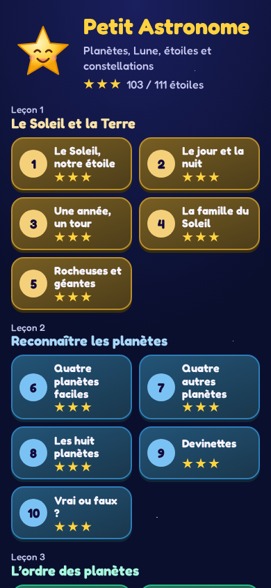
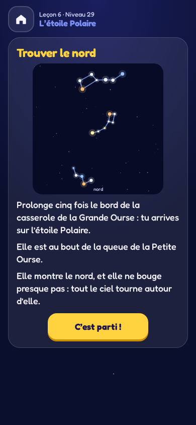
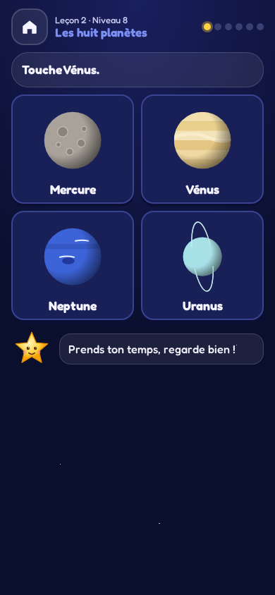
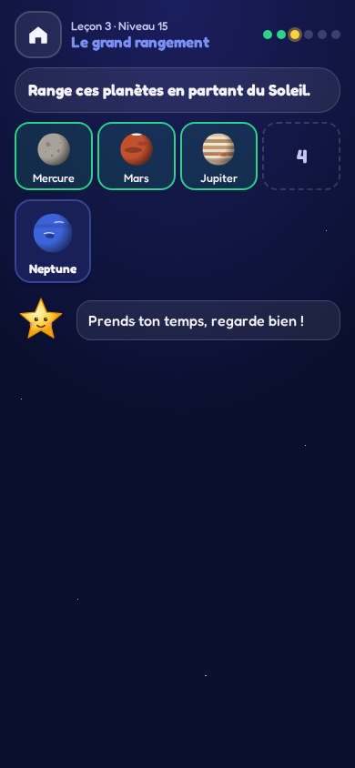
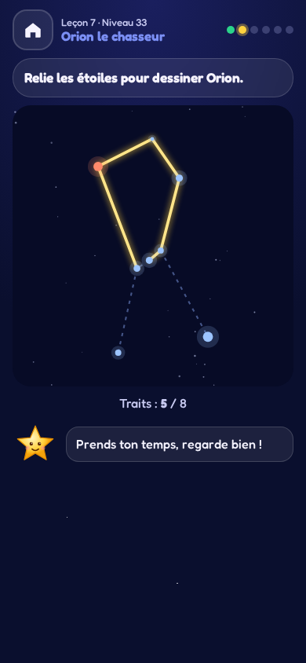
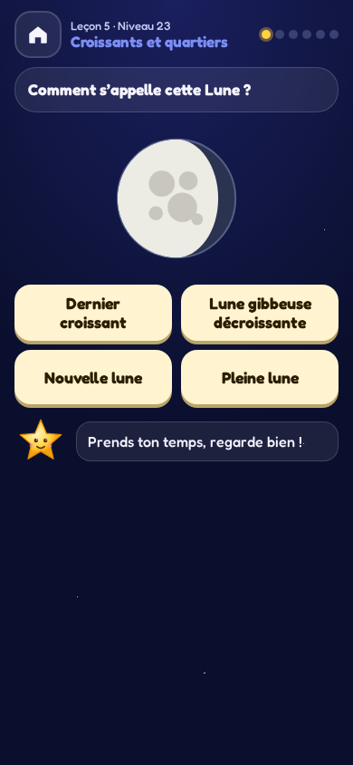
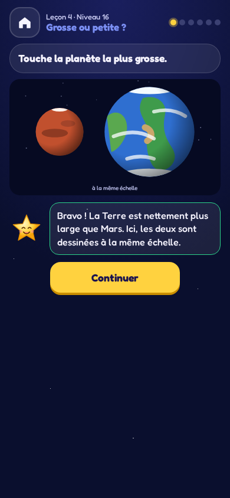
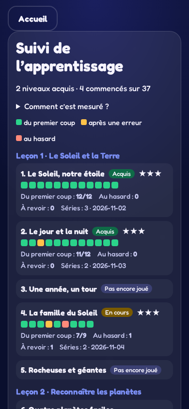

<h2 align="center"><a href="https://davy45270.github.io/petit-astronome/">▶ Jouer / Play</a></h2>
<p align="center">Dans le navigateur, sur téléphone ou ordinateur. Installable, fonctionne hors ligne.</p>

# Petit Astronome

[English](README.md)

Un jeu pour découvrir le ciel dès 6 ans : le Soleil, les huit planètes, la Lune et ses phases, les étoiles et les constellations. Lumi, une petite étoile, accompagne l’enfant. En français. Aucun chronomètre, compte ni publicité.

Trente-sept niveaux en sept leçons : le Soleil et la Terre (jour, nuit, année, saisons), reconnaître les planètes, leur ordre, les tailles et les distances, la Lune, les étoiles, puis les constellations. Chaque niveau s’ouvre sur une carte « notion » qui explique en trois phrases ce qu’on va apprendre ; chaque réponse est suivie de son explication. On choisit une image, on touche la bonne planète dans le système solaire, on range les planètes dans l’ordre, et on relie au doigt les vraies étoiles d’Orion ou de la Grande Ourse.

Les dessins sont faits à la main en SVG à partir de données réelles : rayons et distances des planètes (dessinées **à la même échelle** quand on compare leurs tailles), forme exacte de chaque phase de la Lune vue de France, position réelle des étoiles des constellations (projection du ciel vu du sol, nord en haut, est à gauche). Des tests le vérifient : par exemple, prolonger cinq fois le bord de la Grande Casserole mène bien à l’étoile Polaire.

Chaque série compte six questions ; deux étoiles ouvrent le niveau suivant. Une question manquée revient au début de la série suivante. Un espace parents (derrière une petite multiplication) indique pour chaque niveau s’il est acquis : deux séries récentes avec au moins 11 réponses sur 12 justes du premier coup, aucune réponse au hasard et plus rien à revoir. Il reste sur l’appareil.

## Captures d’écran

Téléphone en portrait de 390 × 844 pixels.

| Accueil et leçons | Carte notion : l’étoile Polaire |
| --- | --- |
|  |  |
| Reconnaître une planète | Ranger les planètes |
|  |  |
| Dessiner Orion au doigt | Les phases de la Lune |
|  |  |
| Tailles à la même échelle | Suivi des parents |
|  |  |

Après compilation (`npm run build`) et installation de Chromium (`npx playwright install chromium`), régénérer les images avec `npm run screenshots`.

## Installer et développer

Dans le navigateur, choisir Installer ou Ajouter à l’écran d’accueil. Après une première visite en ligne, le jeu fonctionne hors connexion.

Utiliser la version Node de `.nvmrc` puis :

```sh
npm ci
npm run dev
npm run lint
npm run typecheck
npm test
npm run build
npx playwright install chromium
npm run test:e2e
```

Les tests unitaires vérifient les données scientifiques, le contenu de chaque niveau (chaque réponse est confrontée aux données), le suivi de maîtrise, la sauvegarde, les dessins et les contrastes. Les tests navigateur couvrent une partie au doigt bruitée (vrais événements tactiles, doigt imprécis) sur les dessins de constellations, les rangements et les scènes, la progression, l’espace parents et le hors-ligne. Les règles précises figurent dans [GAME_SPEC.md](GAME_SPEC.md).

## Vie privée

Les progrès et le suivi des parents restent sur l’appareil. Aucune collecte, aucun traceur, aucune publicité ni requête applicative ; un test interdit tout canal réseau dans le code du jeu. La lecture à voix haute utilise uniquement les voix françaises installées sur l’appareil ; le bouton est masqué s’il n’y en a pas.

Licence MIT © 2026 David Sevin — [LICENSE](LICENSE).
