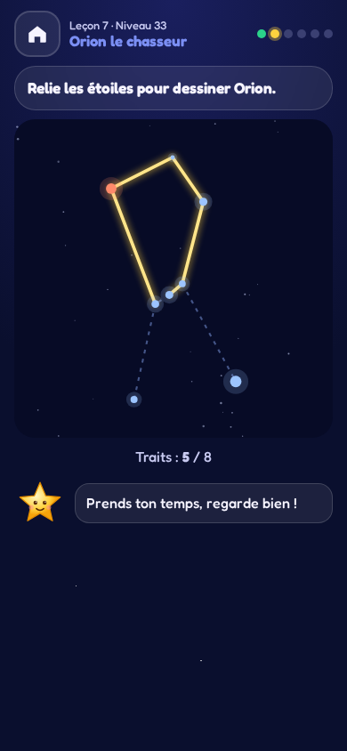
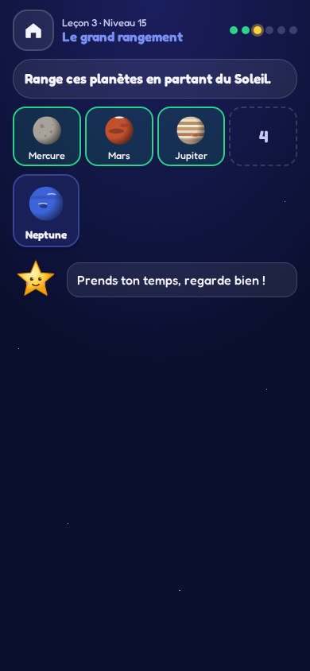
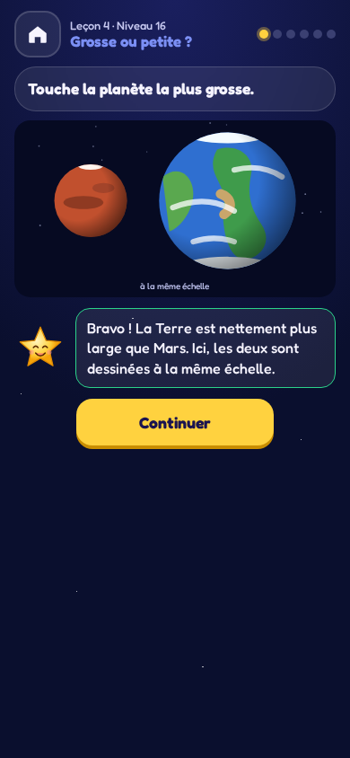

<h2 align="center"><a href="https://davy45270.github.io/petit-astronome/">▶ Jouer / Play</a></h2>

In the browser, on a phone or a computer. Installable, works offline.

# Petit Astronome

[Français](README.fr.md)

An astronomy game for children from 6: the Sun, the eight planets, the Moon and its phases, stars and constellations. Lumi, a little star, guides the child. The game is in French. No timer, account or advertising.

Thirty-seven levels in seven lessons: the Sun and the Earth (day, night, year, seasons), recognising the planets, their order, sizes and distances, the Moon, stars, then constellations. Each level opens with a short notion card, and each answer is followed by its explanation. Children pick a picture, tap the right planet in the solar system, sort the planets, and draw the real stars of Orion or the Big Dipper with a finger.

All drawings are hand-made SVG built from real data: planet radii and distances (drawn **to the same scale** when sizes are compared), the exact shape of every Moon phase as seen from France, and the real positions of constellation stars (a projection of the sky seen from the ground, north up, east left). Tests check it, for instance that extending the edge of the Big Dipper five times leads to the Pole Star.

A session has six questions; two stars open the next level. A missed question comes back at the start of the next session. A parents’ area (behind a small multiplication) shows whether each level is mastered: two recent sessions with at least 11 of 12 answers right on the first try, no random tries and nothing left to review. It stays on the device.

## Screenshots

See the gallery in [README.fr.md](README.fr.md#captures-décran) (phone, portrait, 390 × 844).

  

## Install and develop

Use the Node version from `.nvmrc`, then `npm ci`, `npm run dev`, `npm run lint`, `npm run typecheck`, `npm test`, `npm run build`, `npx playwright install chromium` and `npm run test:e2e`. `npm run screenshots` refreshes the README images. Rules are in [GAME_SPEC.md](GAME_SPEC.md).

## Privacy

Progress and the parents’ follow-up stay on the device. No collection, tracker, advertising or application request; a test forbids any network channel in the game code. Read-aloud only uses French voices installed on the device.

MIT licence © 2026 David Sevin — [LICENSE](LICENSE).
